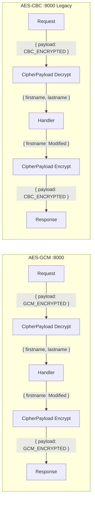

# Example Usage

## Table of Contents

- [Example Usage](#example-usage)
  - [Dependencies](#dependencies)
  - [Structure](#structure)
  - [Servers](#servers)
  - [Get Started](#get-started)
    - [Step 1: Initialize](#step-1-initialize)
    - [Step 2: Run](#step-2-run)
    - [Step 3: Test](#step-3-test)
  - [Tips](#tips)

## Dependencies

- Go 1.27+ with GoFiber v2
- Zerolog - Log Management

## Structure



## Servers

| Port | Mode | Description |
|------|------|-------------|
| `:5000` | Plaintext | No encryption middleware |
| `:8000` | AES-GCM | v2 default, authenticated encryption with random nonce |
| `:8001` | AES-GCM + StrictMode | Error showcase (400/500 responses for invalid payloads) |
| `:9000` | AES-CBC | Legacy mode with fixed IV, backward compatible |

## Get Started

### Step 1: Initialize

```bash
go mod tidy
```

### Step 2: Run

```bash
go run main.go
```

### Step 3: Test

**Plaintext API**:
```bash
curl -X POST http://localhost:5000/api/example \
  -H "Content-Type: application/json" \
  -d '{"firstname":"Chinnawat","lastname":"Chimdee"}'
```

**AES-CBC (legacy) API**:
```bash
curl -X POST http://localhost:9000/api/example \
  -H "Content-Type: application/json" \
  -d '{"payload":"FDp1Dl31zGx5nRXFNKihB+k3ly/L7HI9tlHycbKVRwhaf3RRdyFGviuntEZqst0/"}'
```

**AES-GCM API**: Use [encrypt-tools](https://encrypt-tools.vercel.app/) with AES-GCM mode to generate a payload, then:
```bash
curl -X POST http://localhost:8000/api/example \
  -H "Content-Type: application/json" \
  -d '{"payload":"<your GCM encrypted base64>"}'
```

**StrictMode Error Cases** (`:8001`):
```bash
# Empty body -> 400 Bad Request
curl -X POST http://localhost:8001/api/example \
  -H "Content-Type: application/json" \
  -d '{}'

# Tampered payload -> 400 Bad Request
curl -X POST http://localhost:8001/api/example \
  -H "Content-Type: application/json" \
  -d '{"payload":"!!!invalid!!!"}'

# CBC payload to GCM server -> 400 Bad Request
curl -X POST http://localhost:8001/api/example \
  -H "Content-Type: application/json" \
  -d '{"payload":"FDp1Dl31zGx5nRXFNKihB+k3ly/L7HI9tlHycbKVRwhaf3RRdyFGviuntEZqst0/"}'
```

Demo keys:
- Encrypt key (server decrypts request): `67890123456789012345678901234567`
- Decrypt key (server encrypts response): `12345678901234567890123456789012`
- CBC IV (encrypt): `6789012345678901`
- CBC IV (decrypt): `1234567890123456`

## Tips

- [encrypt-tools](https://encrypt-tools.vercel.app/) - AES encryption/decryption tool (supports both GCM and CBC)
- [Postman](https://www.postman.com/)
- [VSCode Extension: REST Client](https://marketplace.visualstudio.com/items?itemName=humao.rest-client)
